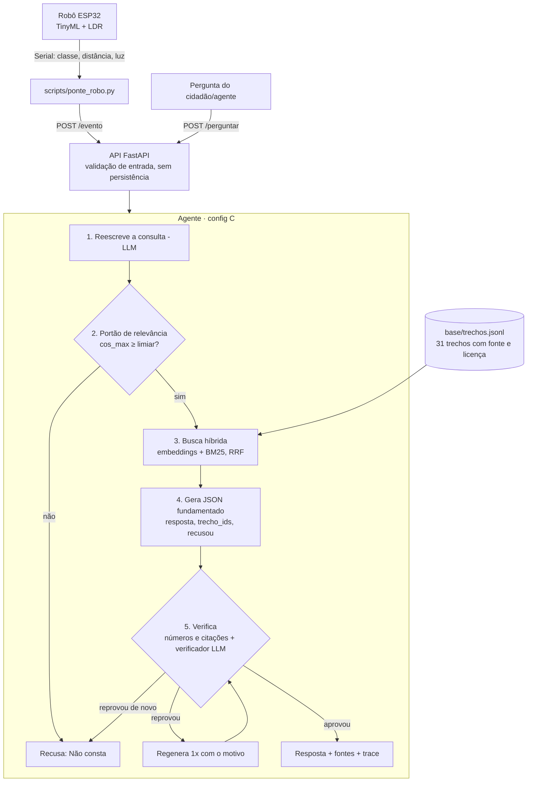

# Relatório · RotaLivre AI

**Generative AI for Engineering · Global Solution 2026.2 · CitizenTech · Engenharia de Software 4º ano (FIAP)**
Componente **Inteligência** do produto **RotaLivre** (o robô-sentinela de calçadas do Project-Based Maker Lab). Instalação e execução: ver [README.md](README.md).

> **Em uma frase:** um LLM local (Ollama) que explica, **com fonte e sem inventar**, qual regra de acessibilidade se aplica quando o robô detecta uma obstrução ou pouca luz, e que **recusa** quando a base não tem a resposta.

## 1. Integrantes

| Nome completo | RM |
| ------------- | -- |
| Bruno Eduardo Caputo Paulino | 558303 |
| Lucas Rodrigues | 98344 |
| Juan Pinheiro de França | 552202 |
| Kaiky Alvaro Miranda | 98118 |

## 2. Ficha Técnica (o que a IA resolve)

| Campo | Resposta |
| ----- | -------- |
| **Nome do produto** | RotaLivre (componente de IA: *RotaLivre AI*) |
| **Cidadão e território** | Pessoas com deficiência visual ou de mobilidade e idosos que dependem de calçadas livres e iluminadas; agentes de zeladoria urbana. Calçadas, corredores e pontos de espera. |
| **Problema, em uma frase** | Calçadas obstruídas ou mal iluminadas tiram a autonomia de quem tem mobilidade reduzida, e saber **qual regra está sendo violada** exige consultar leis e normas dispersas. |
| **Tarefa da IA (tema: Mobilidade)** | Responder perguntas sobre acessibilidade de calçadas **somente com base em trechos com fonte**, em JSON, citando a fonte e recusando quando "não consta"; e **explicar eventos do robô** (obstáculo, aproximação, pouca luz) citando a regra aplicável. |
| **Arquitetura: componentes** | Ollama (LLM + embeddings, local) · base de conhecimento (31 trechos) · busca híbrida (embeddings + BM25) · agente verificador · API FastAPI · ponte Serial do ESP32. |
| **Fontes de dados** | Leis (LBI, CTB), IBGE (Censo 2022), requisitos da NBR 9050 em resumos de cartilhas oficiais e documentação do robô. Ver [`base/FONTES.md`](base/FONTES.md). |
| **Modelos de IA utilizados** | LLM `qwen2.5:7b` e embeddings `bge-m3`, ambos via Ollama (troque com `ROTALIVRE_LLM` e `ROTALIVRE_EMB`; confira a licença no cartão de cada modelo). |
| **Indicadores de impacto** | Taxa de alucinação (menor é melhor), taxa de recusa correta, citação correta e tempo de resposta (seção 5); do lado do robô, obstruções e pouca luz explicadas com fonte. |
| **ODS conectados** | 11 (espaços públicos acessíveis), 10 (inclusão) e 9 (inovação de baixo custo). |

## 3. Diagrama do pipeline de IA

**Por que agente e não LoRA:** roda em GPU de 8 GB sem treino, cada passo é auditável e ataca diretamente o problema (alucinação). **Não fizemos fine-tuning**; a "especialização" é por agente, comparada ao RAG simples no placar. Extensão futura: LoRA sobre perguntas e respostas fundamentadas.

### Segurança, LGPD e IA responsável
- **Sem dados pessoais:** a entrada é uma pergunta curta (≤ 300 caracteres) ou um evento (classe, distância, luminosidade). O robô não tem câmera nem microfone.
- **Nada é gravado:** a API não persiste entradas; o log registra só rota, tamanho e tempo, nunca o conteúdo.
- **Local:** LLM e embeddings rodam no Ollama local; nada é enviado a serviços externos.
- **Entradas validadas** (pydantic: tamanhos, faixas e enumerações); CORS fechado por padrão.
- **Explicável:** toda resposta traz fontes (id, citação, URL, licença) e o *trace* dos passos do agente.
- **Pessoa no circuito:** a API **explica e recomenda verificação humana**; não decide nada pelo cidadão. Toda resposta traz o aviso para conferir a norma vigente.
- **Viés/limites:** a base cobre calçadas e dados nacionais do IBGE; não cobre ciclovias, iluminação pública (lux), multas em R$ nem dados regionais. Essas lacunas são testadas como "não consta".

## 4. Tabela da base de conhecimento

31 trechos curtos de 14 fontes, cada um com `id`, `fonte`, `referencia`, `url`, `formato` e `licenca`. Resumo (tabela completa com URLs e IDs em [`base/FONTES.md`](base/FONTES.md)):

| Fonte | Formato | Licença | Trechos |
| ----- | ------- | ------- | ------: |
| Lei 13.146/2015 (LBI) | HTML/PDF | domínio público (texto de lei) | 3 |
| Lei 9.503/1997 (CTB), art. 181, VIII | HTML/PDF | domínio público (texto de lei) | 1 |
| IBGE, Censo 2022 (Agência de Notícias) | notícia web | resumo parafraseado, citar fonte | 4 |
| Agência Brasil/Band (comparação com 2010) | notícia web | resumo parafraseado, citar fonte | 1 |
| 9 cartilhas/laudos/checklists públicos que resumem a NBR 9050 e a NBR 16537 (PBH, SP, Arapiraca, CREA-RN, AGU, Sudeco, HU-UNIVASF, Instituto de Engenharia, Balneário Camboriú) | PDF/DOCX | resumo parafraseado; **a norma ABNT original é protegida e não é reproduzida** | 16 |
| Documentação do robô RotaLivre | Markdown/TXT | autoria da equipe | 6 |
| **Total** | | | **31** |

## 5. Performance do modelo nas três configurações

> **Resultado registrado:** os números abaixo foram extraídos dos arquivos gerados e versionados em `avaliacao/resultados/` (`placar.md`, `placar.csv`, `recall.csv`, `limiar.json`, `respostas.json`). O notebook 06 registra execução com Ollama, LLM `qwen2.5:7b` e embeddings `bge-m3`. Não foram criados resultados simulados para completar esta seção.

**Casos de teste:** 34 (26 `consta` com gabarito + 8 `nao_consta` de armadilha), em [`avaliacao/casos_teste.jsonl`](avaliacao/casos_teste.jsonl). Reprodutível: `temperature=0`, `seed=7`.

| Configuração | Acerto (%) | Alucinação (%) | JSON válido (%) | Citação correta (%) | Recusa correta em "não consta" (%) | Recusa indevida em "consta" (%) |
| ------------ | ---------: | -------------: | --------------: | ------------------: | ---------------------------------: | ------------------------------: |
| A · sem contexto | 17,6 | 52,9 | 100,0 | 23,5 | 25,0 | 11,5 |
| B · RAG simples | **94,1** | **0,0** | 100,0 | **91,2** | 100,0 | **3,8** |
| C · agente | 76,5 | **0,0** | 100,0 | 76,5 | 100,0 | 30,8 |

**Busca (notebook 03):** os resultados de `recall.csv` foram: embeddings — recall@1 **0,846** e recall@3 **0,923**; BM25 — recall@1 **0,769** e recall@3 **0,885**; busca híbrida — recall@1 **0,846** e recall@3 **0,885**. O limiar escolhido foi **0,694** para `cos_max`, calibrado por Youden J (**J = 0,731**), com TPR para casos `consta` de **0,731** e TNR para `nao_consta` de **1,000**, conforme `limiar.json`.

### Como as métricas são definidas
- **Acerto:** em `consta`, JSON válido, não recusou e contém todos os grupos de `deve_conter`; em `nao_consta`, recusou.
- **Alucinação:** em `consta`, citou trecho inexistente ou trouxe número que não está na pergunta, no gabarito, nos trechos que ela mesma citou nem em identificadores de norma; em `nao_consta`, respondeu em vez de recusar.
- **Recusa indevida:** recusou algo que a base respondia (erro de omissão, não conta como alucinação).
- **Citação correta:** citou ao menos um trecho do gabarito (em `nao_consta`, não citar nada).
- **Limitações das métricas:** a checagem por palavras-chave é conservadora e pode reprovar respostas corretas escritas de outro jeito (leia as respostas em `respostas.json`); com 34 casos, diferenças pequenas não são estatisticamente significativas.

### Interpretação
Os resultados mostram um salto expressivo de A para B: o RAG simples elevou o acerto de **17,6% para 94,1%**, reduziu a alucinação de **52,9% para 0%**, aumentou a citação correta de **23,5% para 91,2%** e passou a recusar corretamente todos os oito casos `nao_consta`. O contexto recuperado da base foi decisivo para restringir as respostas e ancorá-las em fontes.

De B para C, o agente manteve **0% de alucinação** e **100% de recusa correta** nos casos `nao_consta`, mas o acerto caiu de **94,1% para 76,5%**, a citação correta caiu de **91,2% para 76,5%** e a recusa indevida em perguntas que a base respondia subiu de **3,8% para 30,8%**. O trace mostra dois mecanismos de recusa excessivamente conservadores: o portão rejeitou perguntas respondíveis quando a similaridade máxima ficou pouco abaixo de 0,694 (por exemplo, C01 com 0,673 e C21 com 0,624); em outros casos, a busca passou pelo portão, mas a recuperação/geração não produziu uma resposta citada (C02).

Portanto, neste conjunto de testes, o agente troca cobertura por cautela: evita responder sem evidência, mas também deixa de responder perguntas cobertas pela base. Para este produto, isso reduz o risco de orientação inventada, porém prejudica a utilidade para o cidadão e a explicação dos eventos do robô. O RAG simples apresentou o melhor equilíbrio medido neste experimento. A amostra tem apenas 34 perguntas, então os percentuais devem ser tratados como evidência exploratória, não como prova estatística de superioridade geral.

## 6. Os 5 erros reais, a causa e a correção proposta

O notebook 06 gerou [`avaliacao/resultados/erros_candidatos.md`](avaliacao/resultados/erros_candidatos.md) com os erros observados. Foram selecionados abaixo cinco casos de configurações e causas variadas, conferidos nos registros de `respostas.json`:

| # | Config / caso | O que aconteceu | Causa (confirmada nos dados) | Correção proposta |
| - | ------------- | --------------- | ---------------------------- | ----------------- |
| 1 | A · C14 | Respondeu que a altura livre mínima para obstáculos verticais seria 0,85 m. | A configuração A não recebe contexto recuperado nem trechos da base; a resposta gerou um valor numérico não sustentado. O erro foi classificado como número fora da base (`0.85`). | Não usar a resposta sem contexto em produção. Exigir recuperação de trechos e validação de números contra a evidência citada; se não houver suporte, recusar. |
| 2 | A · N01 | Informou uma faixa estimada de multa em reais para estacionar na calçada. | N01 é um caso `nao_consta`: a base declara explicitamente que não contém o valor da multa. Sem contexto e sem mecanismo de recusa, o modelo completou com conhecimento presumido. | Manter a política de recusa para lacunas; não permitir estimativas ou conhecimento paramétrico quando a tarefa exige resposta exclusivamente baseada na base. |
| 3 | B · C02 | Perguntava a altura livre mínima da faixa livre, mas respondeu com a largura mínima de 1,20 m. | O trace de busca retornou T16, T13 e T17 (similaridades 0,762; 0,733; 0,707), e não recuperou o trecho T22 que aparece em respostas corretas relacionadas à altura livre (como C14). A resposta ficou ancorada em informação de largura, não na dimensão perguntada. | Melhorar a recuperação com reranker e/ou expansão de consulta; incluir testes que diferenciem largura e altura; validar se a resposta cobre exatamente o atributo solicitado antes de aceitá-la. |
| 4 | C · C01 | Recusou responder sobre a largura mínima da faixa livre, embora a base contenha a informação. | O trace registra `cos_max = 0,673`, abaixo do limiar `0,694`; o portão encerrou o fluxo antes da busca híbrida e da geração. | Recalibrar o limiar com mais perguntas, testar limiares por tema e permitir uma segunda tentativa de recuperação antes da recusa. Medir explicitamente o custo em recusas indevidas. |
| 5 | C · C22 | Recusou explicar a classe `aproximando`, apesar de a documentação do robô estar na base. | O trace registra `cos_max = 0,595`, abaixo do limiar `0,694`; a busca foi bloqueada pelo portão de relevância. O problema é consistente com a baixa similaridade das consultas reescritas para o tema `robo`. | Melhorar a redação/indexação dos trechos de documentação do robô, adicionar exemplos de consultas equivalentes e avaliar limiar específico para esse tema antes de recusar. |

*Causas típicas a verificar (não são resultados): trecho do gabarito fora do top-3; limiar de recusa muito alto ou baixo; pergunta "não consta" lexicalmente parecida com a base; palavra-chave do gabarito escrita de outra forma; verificador LLM aprovando algo parcial.*

## 7. Conclusão técnica e links

Neste experimento, tanto o RAG simples quanto o agente tiveram **0% de alucinação medida**, contra **52,9%** na configuração sem contexto. Entretanto, o agente não superou o RAG simples no resultado geral: teve menos acertos (76,5% contra 94,1%), menos citações corretas (76,5% contra 91,2%) e muito mais recusas indevidas (30,8% contra 3,8%). Assim, a especialização por agente e verificador aumentou a cautela, mas o limiar e a recuperação atuais estão conservadores demais para perguntas que a base efetivamente responde.

Como próximos passos, priorizaríamos: (1) ampliar a base e os casos de teste, sobretudo paráfrases sobre dimensões de calçadas e eventos do robô; (2) melhorar a recuperação com reranker, expansão de consulta e avaliação por tema; (3) recalibrar o limiar com um conjunto maior e separado de validação; (4) revisar os critérios do verificador para distinguir falta real de evidência de falha de recuperação; e (5) incluir contexto estruturado do evento (classe, distância e leitura do LDR) na consulta à base. LoRA pode ser investigado depois, mas não é a primeira correção indicada pelos erros observados: os traces apontam principalmente para recuperação e política de recusa.

- Repositório desta matéria: [github.com/Brunin16/gs-ia-26](https://github.com/Brunin16/gs-ia-26) (URL indicada no README do projeto).
- Vídeo: **não informado nos arquivos fornecidos**; inserir o link de apresentação quando disponível.
- Robô (Maker Lab): **não há URL externa específica nos arquivos fornecidos**; o projeto descreve a integração e a ponte Serial em `scripts/ponte_robo.py`.

## Mapa de entrega × critérios

| # | Critério | Onde está |
| - | -------- | --------- |
| 01 | Tarefa da IA e casos de teste com gabarito, incluindo "não consta" | `notebooks/01`, `avaliacao/casos_teste.jsonl` |
| 02 | Base de conhecimento em trechos com fonte | `base/trechos.jsonl`, `base/FONTES.md`, `notebooks/02` |
| 03 | Busca com recall@1/@3 e limiar justificado | `notebooks/03`, `avaliacao/resultados/` |
| 04 | Geração fundamentada: JSON, citação e recusa | `rotalivre_ai/pipelines.py`, `notebooks/04` |
| 05 | Especialização (agente) comparada ao RAG simples | `notebooks/05`, `pipelines.responder_agente` |
| 06 | Placar das três configurações, interpretado | `notebooks/06`, seção 5 |
| 07 | 5 erros reais com correção | seção 6 |
| 08 | README e reprodutibilidade | [README.md](README.md) (instalação do zero), `instalar.bat`/`instalar.sh`, `requirements.txt`, `tests/` |

## Integração com o produto

A API (`rodar.bat` opção 3) expõe:

| Endpoint | Uso |
| -------- | --- |
| `GET /saude` | status, nº de trechos, backend |
| `POST /perguntar` | `{"pergunta": "...", "modo": "agente" ou "rag"}` → resposta, fontes, trace e aviso |
| `POST /evento` | `{"classe": "obstaculo", "distancia_cm": 12.5, "luminosidade": 800}` → explicações com fonte e **ação recomendada (verificação humana)** |

O carrinho (firmware **sem alterações**) imprime no Serial `[... ms] [TINYML] ACAO -> obstaculo` e `[... ms] [LDR] valor=900 (farol ON)`. O `scripts/ponte_robo.py` (`rodar.bat` opções 4 e 5) lê essas linhas e chama `/evento` a cada mudança de classe.
