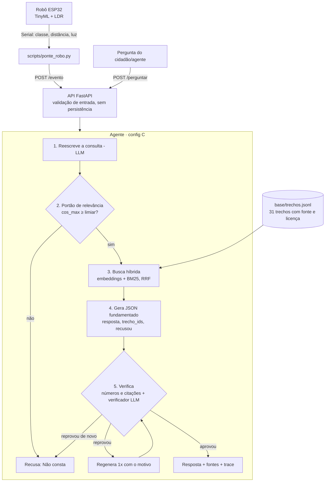

# Relatório · RotaLivre AI

**Generative AI for Engineering · Global Solution 2026.2 · CitizenTech · Engenharia de Software 4º ano (FIAP)**
Componente **Inteligência** do produto **RotaLivre** (o robô-sentinela de calçadas do Project-Based Maker Lab). Instalação e execução: ver [README.md](README.md).

> **Em uma frase:** um LLM local (Ollama) que explica, **com fonte e sem inventar**, qual regra de acessibilidade se aplica quando o robô detecta uma obstrução ou pouca luz, e que **recusa** quando a base não tem a resposta.

## 1. Integrantes

| Nome completo | RM |
| ------------- | -- |
| Bruno Eduardo Caputo Paulino | 558303 |
| Lucas Rodrigues | 98344 |
| Juan Pinheiro de França | 552202 |
| Kaiky Alvaro Miranda | 98118 |

## 2. Ficha Técnica (o que a IA resolve)

| Campo | Resposta |
| ----- | -------- |
| **Nome do produto** | RotaLivre (componente de IA: *RotaLivre AI*) |
| **Cidadão e território** | Pessoas com deficiência visual ou de mobilidade e idosos que dependem de calçadas livres e iluminadas; agentes de zeladoria urbana. Calçadas, corredores e pontos de espera. |
| **Problema, em uma frase** | Calçadas obstruídas ou mal iluminadas tiram a autonomia de quem tem mobilidade reduzida, e saber **qual regra está sendo violada** exige consultar leis e normas dispersas. |
| **Tarefa da IA (tema: Mobilidade)** | Responder perguntas sobre acessibilidade de calçadas **somente com base em trechos com fonte**, em JSON, citando a fonte e recusando quando "não consta"; e **explicar eventos do robô** (obstáculo, aproximação, pouca luz) citando a regra aplicável. |
| **Arquitetura: componentes** | Ollama (LLM + embeddings, local) · base de conhecimento (31 trechos) · busca híbrida (embeddings + BM25) · agente verificador · API FastAPI · ponte Serial do ESP32. |
| **Fontes de dados** | Leis (LBI, CTB), IBGE (Censo 2022), requisitos da NBR 9050 em resumos de cartilhas oficiais e documentação do robô. Ver [`base/FONTES.md`](base/FONTES.md). |
| **Modelos de IA utilizados** | LLM `qwen2.5:7b` e embeddings `bge-m3`, ambos via Ollama (troque com `ROTALIVRE_LLM` e `ROTALIVRE_EMB`; confira a licença no cartão de cada modelo). |
| **Indicadores de impacto** | Taxa de alucinação (menor é melhor), taxa de recusa correta, citação correta e tempo de resposta (seção 5); do lado do robô, obstruções e pouca luz explicadas com fonte. |
| **ODS conectados** | 11 (espaços públicos acessíveis), 10 (inclusão) e 9 (inovação de baixo custo). |

## 3. Diagrama do pipeline de IA

**Por que agente e não LoRA:** roda em GPU de 8 GB sem treino, cada passo é auditável e ataca diretamente o problema (alucinação). **Não fizemos fine-tuning**; a "especialização" é por agente, comparada ao RAG simples no placar. Extensão futura: LoRA sobre perguntas e respostas fundamentadas.

### Segurança, LGPD e IA responsável
- **Sem dados pessoais:** a entrada é uma pergunta curta (≤ 300 caracteres) ou um evento (classe, distância, luminosidade). O robô não tem câmera nem microfone.
- **Nada é gravado:** a API não persiste entradas; o log registra só rota, tamanho e tempo, nunca o conteúdo.
- **Local:** LLM e embeddings rodam no Ollama local; nada é enviado a serviços externos.
- **Entradas validadas** (pydantic: tamanhos, faixas e enumerações); CORS fechado por padrão.
- **Explicável:** toda resposta traz fontes (id, citação, URL, licença) e o *trace* dos passos do agente.
- **Pessoa no circuito:** a API **explica e recomenda verificação humana**; não decide nada pelo cidadão. Toda resposta traz o aviso para conferir a norma vigente.
- **Viés/limites:** a base cobre calçadas e dados nacionais do IBGE; não cobre ciclovias, iluminação pública (lux), multas em R$ nem dados regionais. Essas lacunas são testadas como "não consta".

## 4. Tabela da base de conhecimento

31 trechos curtos de 14 fontes, cada um com `id`, `fonte`, `referencia`, `url`, `formato` e `licenca`. Resumo (tabela completa com URLs e IDs em [`base/FONTES.md`](base/FONTES.md)):

| Fonte | Formato | Licença | Trechos |
| ----- | ------- | ------- | ------: |
| Lei 13.146/2015 (LBI) | HTML/PDF | domínio público (texto de lei) | 3 |
| Lei 9.503/1997 (CTB), art. 181, VIII | HTML/PDF | domínio público (texto de lei) | 1 |
| IBGE, Censo 2022 (Agência de Notícias) | notícia web | resumo parafraseado, citar fonte | 4 |
| Agência Brasil/Band (comparação com 2010) | notícia web | resumo parafraseado, citar fonte | 1 |
| 9 cartilhas/laudos/checklists públicos que resumem a NBR 9050 e a NBR 16537 (PBH, SP, Arapiraca, CREA-RN, AGU, Sudeco, HU-UNIVASF, Instituto de Engenharia, Balneário Camboriú) | PDF/DOCX | resumo parafraseado; **a norma ABNT original é protegida e não é reproduzida** | 16 |
| Documentação do robô RotaLivre | Markdown/TXT | autoria da equipe | 6 |
| **Total** | | | **31** |

## 5. Performance do modelo nas três configurações

> **Status:** os notebooks, os 34 casos de teste e as métricas estão prontos. **Os números abaixo devem ser colados do arquivo gerado por você ao rodar o notebook 06 com o Ollama** ([`avaliacao/resultados/placar.md`](avaliacao/resultados/placar.md)). Não há números simulados neste repositório.

**Casos de teste:** 34 (26 `consta` com gabarito + 8 `nao_consta` de armadilha), em [`avaliacao/casos_teste.jsonl`](avaliacao/casos_teste.jsonl). Reprodutível: `temperature=0`, `seed=7`.

| Configuração | Acerto (%) | Alucinação (%) | JSON válido (%) | Citação correta (%) | Recusa correta em "não consta" (%) | Recusa indevida em "consta" (%) |
| ------------ | ---------: | -------------: | --------------: | ------------------: | ---------------------------------: | ------------------------------: |
| A · sem contexto | **[PREENCHER]** | | | | | |
| B · RAG simples | | | | | | |
| C · agente | | | | | | |

**Busca (notebook 03):** recall@1 e recall@3 de embeddings, BM25 e híbrida em [`avaliacao/resultados/recall.csv`](avaliacao/resultados/recall.csv); limiar de recusa e sua justificativa (Youden J) em `limiar.json` e `limiar.png`. **[PREENCHER: recall@1 / recall@3 e limiar escolhido]**

### Como as métricas são definidas
- **Acerto:** em `consta`, JSON válido, não recusou e contém todos os grupos de `deve_conter`; em `nao_consta`, recusou.
- **Alucinação:** em `consta`, citou trecho inexistente ou trouxe número que não está na pergunta, no gabarito, nos trechos que ela mesma citou nem em identificadores de norma; em `nao_consta`, respondeu em vez de recusar.
- **Recusa indevida:** recusou algo que a base respondia (erro de omissão, não conta como alucinação).
- **Citação correta:** citou ao menos um trecho do gabarito (em `nao_consta`, não citar nada).
- **Limitações das métricas:** a checagem por palavras-chave é conservadora e pode reprovar respostas corretas escritas de outro jeito (leia as respostas em `respostas.json`); com 34 casos, diferenças pequenas não são estatisticamente significativas.

### Interpretação
**[PREENCHER: use o texto gerado pelo notebook 06 ("Resultados interpretados") e acrescente sua leitura: o que mudou de A para B e de B para C, onde o agente recusou demais, o que isso custa.]**

## 6. Os 5 erros reais, a causa e a correção proposta

O notebook 06 gera [`avaliacao/resultados/erros_candidatos.md`](avaliacao/resultados/erros_candidatos.md) com **os erros que realmente ocorreram**. Escolha 5 (tipos e configurações variados), investigue o *trace* em `respostas.json` e preencha:

| # | Config / caso | O que aconteceu | Causa (confirmada nos dados) | Correção proposta |
| - | ------------- | --------------- | ---------------------------- | ----------------- |
| 1 | **[PREENCHER]** | | | |
| 2 | | | | |
| 3 | | | | |
| 4 | | | | |
| 5 | | | | |

*Causas típicas a verificar (não são resultados): trecho do gabarito fora do top-3; limiar de recusa muito alto ou baixo; pergunta "não consta" lexicalmente parecida com a base; palavra-chave do gabarito escrita de outra forma; verificador LLM aprovando algo parcial.*

## 7. Conclusão técnica e links

**[PREENCHER: conclusão após os resultados: o agente alucinou menos que o RAG simples e que o modelo sem contexto? A que custo (recusas indevidas)? O que faria a seguir: mais trechos e casos, LoRA, reranker, LDR e distância como contexto do evento.]**

- Repositório desta matéria: **[PREENCHER]**
- Vídeo: **[PREENCHER]**
- Robô (Maker Lab): **[PREENCHER]**

## Mapa de entrega × critérios

| # | Critério | Onde está |
| - | -------- | --------- |
| 01 | Tarefa da IA e casos de teste com gabarito, incluindo "não consta" | `notebooks/01`, `avaliacao/casos_teste.jsonl` |
| 02 | Base de conhecimento em trechos com fonte | `base/trechos.jsonl`, `base/FONTES.md`, `notebooks/02` |
| 03 | Busca com recall@1/@3 e limiar justificado | `notebooks/03`, `avaliacao/resultados/` |
| 04 | Geração fundamentada: JSON, citação e recusa | `rotalivre_ai/pipelines.py`, `notebooks/04` |
| 05 | Especialização (agente) comparada ao RAG simples | `notebooks/05`, `pipelines.responder_agente` |
| 06 | Placar das três configurações, interpretado | `notebooks/06`, seção 5 |
| 07 | 5 erros reais com correção | seção 6 |
| 08 | README e reprodutibilidade | [README.md](README.md) (instalação do zero), `instalar.bat`/`instalar.sh`, `requirements.txt`, `tests/` |

## Integração com o produto

A API (`rodar.bat` opção 3) expõe:

| Endpoint | Uso |
| -------- | --- |
| `GET /saude` | status, nº de trechos, backend |
| `POST /perguntar` | `{"pergunta": "...", "modo": "agente" ou "rag"}` → resposta, fontes, trace e aviso |
| `POST /evento` | `{"classe": "obstaculo", "distancia_cm": 12.5, "luminosidade": 800}` → explicações com fonte e **ação recomendada (verificação humana)** |

O carrinho (firmware **sem alterações**) imprime no Serial `[... ms] [TINYML] ACAO -> obstaculo` e `[... ms] [LDR] valor=900 (farol ON)`. O `scripts/ponte_robo.py` (`rodar.bat` opções 4 e 5) lê essas linhas e chama `/evento` a cada mudança de classe.
